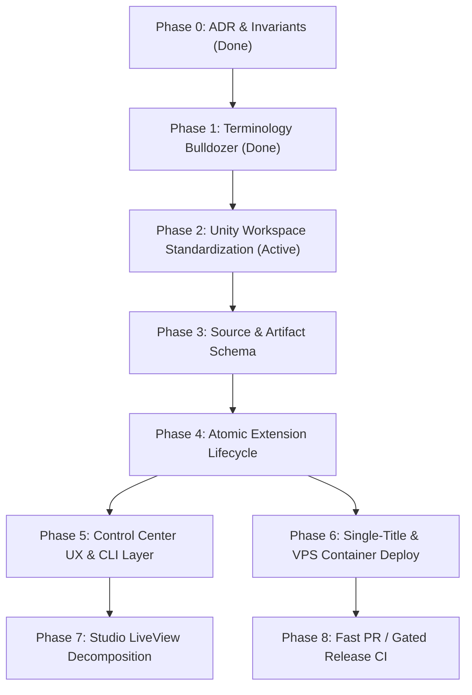

# Exoforge Architecture & Plan (`plan.md`)

> **Status**: Kernel, 14 standard extensions, C# Client SDK, C# Extension SDK, C# Management Engine (`exo`
> CLI), Unity SDK (`com.exoforge.sdk` v0.1.31), Producer Studio, clustering, CI/CD pipeline, and Arch Linux staging deploy are
> **complete** — **320 Elixir + 133 C# = 453 tests passing**, plus a live E2E vertical slice of 6 tests
> against a running server and Unity headless check (`just sample-check`).
> **MVP Status**: Phase 0 (ADR 001 Architecture Decision Record) & Phase 1 (Extension Terminology Bulldozer) **Completed**.
> **Benchmark**: 0.07 ms fanout to 50 event subscribers over `:pg`.

Completed work is not kept here. It is in `git log`, which is the record that does not drift; this
file is the invariants and what is next. Milestone identifiers (**M1**…**M44**) are historical and are
referenced from `Agents.MD`, `DX.md` and commit messages, so they stay in the table below and nowhere
else.

---

## 1. Ground Truth & Invariants

**The Rule**: everything above the kernel is an extension.
**The Exception**: the kernel is not — `ExtensionRegistry`, `ActionDispatcher`, `EventDispatcher`,
`WorkerRegistry`, `ExtensionSupervisor`, `ExtensionBootstrapper`.

- **Service atoms, never module names.** Extensions depend on `:database`, `:auth`, `:player_data`.
  Swapping PostgreSQL for SQLite changes no consumer.
- **Pure C# outside Mix.** Game developers have no Elixir toolchain. Workspace init, scaffolding,
  codegen and deploy are pure C# (`netstandard2.1`).
- **The Unity package is the unit of distribution.** It ships into projects with no Exoforge checkout
  anywhere near them, so it must work exactly as it is shipped.
- **The instance is the unit of deployment.** A developer has Unity, the package and their own
  extensions; the kernel and the standard extensions run somewhere else and are reached over the wire.
  Anything that assumes a checkout — a `_build` path, a `just` recipe, a sibling directory — is a
  tool for this repository's own team, not for a user.
- **No engine SDK owns engine-agnostic code.** The C# client and the extension tooling belong to the
  dotnet side; each engine ships them as a compiled assembly. Adding an engine adds a bucket that
  ships those libraries, not one that reimplements them.
- **A project names no other project's path.** Where a build input comes from is a property of the
  environment, decided by the hooks in `Directory.Build.targets`, not by a reference in a `.csproj`.

```
database ──▶ auth ──▶ player_data
               │
               ├──▶ http (:4001)
               ├──▶ ws   (:4000)
database ──────┴──▶ dashboard (:4005)
extension_manager ─▶ (independent root)
```

---

## 2. Completed Milestones

| M | Delivered |
| :--- | :--- |
| **M1–M6** | Kernel (`PluginRegistry` ETS, `ActionDispatcher`, `EventDispatcher`), Bandit HTTP/WS ingress, SQLite DB, Auth, PlayerData |
| **M7–M13** | Producer Studio (LiveView, `:4005`), Horde delta-CRDT virtual actors, `:pg` event fanout, cluster benchmark, Kubernetes manifests |
| **M14–M17** | `Cmd+K` palette, actor passivation, typed resources (`[ExoResource]`), dynamic action forms, C# client generation |
| **M18** | Zero compiler warnings, WebSocket `AuthenticateAsync`, green E2E slice |
| **M19** | `exoforge_std_extension_manager`: hot extension upload, runtime reload, manifest export |
| **M20** | C# Management engine + `exo` CLI — `init`, `extension new\|build\|push\|dev\|reload\|logs\|stubs\|list\|remove`, `sync`, `status`. `push` verifies the deployed version; `dev` redeploys on save; `logs` reads back extension output |
| **M21** | Unity SDK `com.exoforge.sdk` — one game-facing entry point (`ExoforgeSDK.Auth`/`.Client`/`.ConnectAsync`), device-keyed two-stage anonymous sign-in, prefab created on demand, `Samples~/BasicUsage` |
| **M22** | Control Center window — cluster ping, environment switcher, event monitor, action sandbox, extension scaffold/build/deploy/logs, typed codegen. Split across `ExoforgeControlCenter*.cs` partials; `just pack-unity` builds the tarball |
| **M23** | SQLite local mode — `Exoforge.Std.Database.Adapters.Sqlite` + `:sqlite` driver, no PostgreSQL daemon needed |
| **M24** | Extension Tooling DX ([`DX.md`](docs/archive/DX.md)) — 21 fixes across extension creation, upload and management |
| **M25** | LiveOps *(withdrawn)* — time windows, schedule timeline and calendar view removed; game rules belong in the game, not the platform |
| **M26** | `Exoforge.Plugin.Generator` — a Roslyn source generator replaces the out-of-process `ManifestGen` tool. The manifest, the entry point, the action/event dispatch table and the contract interfaces come from the extension's own compile, so every build shares one pipeline, the host no longer reflects over a generated extension's methods, and a C# extension declares services on a class or on a contract interface in its own assembly |
| **M27** | Self-Contained Unity Package — no symlink leaves the package, no path is resolved by walking out of it, and nothing in package code names this repository's layout |
| **M28** | SDK Runtime Hardening — four correctness bugs and six DX problems on the game-facing path, each with a test that fails when the fix is reverted |
| **M29** | Engine-Agnostic C# Core — the C# client and extension tooling moved out of the Unity package, which now contains only Unity-specific code and ships the libraries as binaries |
| **M30** | Duplication and Build-Step Cleanup — one code generator, one manifest path, no second implementation of anything |
| **M31** | Dev Hooks and the Extension Feed — `Directory.Build.targets` supplies an extension's SDK, generator and manifest plumbing from a single opt-in, the Unity package stages its own libraries by building, and `Exoforge.Plugin.SDK` packs into a feed an extension outside this repository builds against |
| **M32** | Framework-Dependent Extensions and Usage Metering — AOT dropped for IL on a runtime in the image (reflections serialises without generated help), deployment defaults + `EXOFORGE001/2` guards, protocol handshake, `kill -9` isolation as a real test, PDBs shipped; per-extension usage counters (`Exoforge.Metering`), `exoforge_std_metering` persisting deltas with the `title_id`/`studio_id` shape, rollups and `exo extension usage` |
| **M33** | Full-Stack Security & Hardening — the whole-repo audit's 36 fixes: kernel auth/ingress (scope clamp, takeover guard, staff-gated user management, dev-prefix gate, WS identity spoofing), C# host frame buffering, database provisioning once + pooled PostgreSQL + `table_columns` + positional-arg rejection, metering flush batching, async guard tests, event dedup; Unity SDK staff-only editor with zero guest access, crash-free background reconnect/teardown, sanitized build config; dashboard XSS, session-staff enforcement, verified-scope dispatch, HttpOnly cookies, prod secrets |
| **M34** | Extension Terminology, Static Holder `Exo` & C# Toolbox Hardening — `[ExoExtension]`, `ExtensionHost`, static capability holder `Exo` (`Exo.Database`, `Exo.Log`, `Exo.Events`, `Exo.Services`) with tree-shaking, singleton resources (`[ExoSingletonResource]`, `First<T>`), deterministic `Result<T>`; offline packaging (`just pack-sdk` / `just pack-unity`, embedded `NuGet~` feed, pre-packed `System.Text.Json`), dynamic `.NET 9+` TFM detection, `Exoforge.Generated.asmdef` isolation, active in-use stub preservation during sync, collision hardening in `ExoCodeGenerator`, and normalized `service_not_found` diagnostics |
| **M35** | Studio LiveView Overhaul, Project Metadata & Staging CI/CD — Theme engine (dark/light mode contrast), telemetry rendering optimization, throughput graph, deterministic action colors, event deduplication, persistent cluster events; project metadata persistence (`ProjectMetadata`, title/studio settings modal, Unity SDK sync); dynamic CORS policy and WebSocket studio dispatch; SDK bucket downloads; GitHub Actions CI/CD with volume persistence; Arch Linux staging guide (`deploy/STAGING_DEPLOY.md`) and deployment automation |
| **M36** | ADR 001 & Extension Terminology Bulldozer — Recorded ADR 001 (Unity-first, single-title, native extensions, immutable deployment, VPS containers). Bulldozed all platform code from "plugin" to "extension", renamed `plugins/` → `extensions/`, purged fallback wrappers (`plugins_csharp`, `PLUGINS_PATH`, `plugin_manager`), and standardized kernel registries and drivers |
| **M37** | Unity SDK v0.1.30 & Extension DX Hardening — Standalone IDE solution launching (`<name>.sln`) bypassing Unity parent project evaluation; client API symmetry (`ExoServices.<Service>`); blank/minimal template scaffolding; enforced Unity player auth doctrine (`ExoforgeSDK.Auth`); cluster package version resolution & semantic version sorting in `file_bucket`; .NET 9+ SDK and runtime packs validation (`ExoforgeDotnetValidator`); global error logging (`ExoClient.OnError` -> `Debug.LogError`) and actionable `service_not_found` diagnostics |
| **M38** | Extension Fault Isolation & Musl/Alpine RID Support (v0.1.31) — Dynamic musl/Alpine detection on cluster (`linux-musl-x64`) with `EXOFORGE_TARGET_RID` support; Unity Editor RID targeting with `linux-musl-x64` prewarming and default container targeting; supervisor fault isolation using `restart: :temporary` on extension supervisors, pre-handshake exit isolation, and crash registry tracking (`mark_crashed`) to prevent crash loop cascade to root supervisor |
| **M39** | Studio Telemetry, Top Bar Centering & Ingress Hardening (v0.1.34) — Real-time metering pipeline feeding action throughput and non-zero error charts; centered Studio top bar with dynamic label omission and 4-item pin cap; 85vh live event stream modal with server-side syntax highlighting, payload folding, and automated error detection; unprivileged `ActionDispatcher.dispatch` deny-by-default (`[]`) with `dispatch_internal` for privileged orchestration; auth synthesis of env admin accounts in `list_users` ensuring visibility before database bootstrap |
| **M44** | Capture on Demand & Replay — `Exoforge.DebugCapture` keeps expiring rules (player, action or global) in `persistent_term`; a matched top-level dispatch inherits `capture: :deep`, traces even when the global trace is off, and keeps the full request in a bounded in-memory ring (50 × 64 KB, too-large payloads marked, never persisted); `observability.replay` re-dispatches a captured request as its original caller under a new rid; the Studio timeline hosts the capture form, the countdown/stop list and a replay button per captured call, and the user drawer starts a 60-second capture for that account |
| **M43** | Action Health & Percentiles — `Exoforge.Metering` records a log-scale latency histogram and reports p50/p95 per action; `observability.health` joins the 30-minute trace rates with those percentiles and composes a "needs attention" list (newest failures, slow actions, restarting extensions); the Overview throughput card renders that strip with a timeline link per failure, and the actions modal gains a p95 column |
| **M42** | Event Retention, Rollups & Archive — the event store grows a day column, indexes and batched ingest; hourly rollups survive the raw rows; every day older than `EXOFORGE_EVENT_HOT_DAYS` (default 30) is exported to `events-YYYY-MM-DD.ndjson.gz`, catalogued in `event_archives`, and only then deleted (a failed export keeps the rows); `observability.events` pages the hot table and falls back to a capped archive scan for older ranges; the user inspector's Events tab reads that history with paging and an archive toggle; `auth.delete_user` purges the caller's hot events |
| **M41** | Observability Extension & Request Timeline — `exoforge_std_observability` owns the cluster event store (moved out of the Studio) and the `observability` contract (`recent_events`, `error_groups`, `timeline`, `clear_events`); the Studio keeps its own live tail from the event bus and reads history through the service; the timeline drawer joins one request's calls, events, log lines and failure by rid, opened from a failure group, a trace sample, an event row or a pasted id; trace samples carry `kind` and a captured request keeps its queries and host calls |
| **M40** | Live Debugging Spine — `Exoforge.RequestContext` (origin, request id, depth, capture) replaces the pdict origin and stamps events, log lines, trace samples, WS/HTTP responses and native host calls; `Exoforge.ErrorGroups` groups failures by action+reason with counts, first/last seen, callers and a masked sample with its rid; `PayloadPreview` extracted from the trace; the Studio's error mode lists failure groups with copyable request ids; the `50 ms` log-window heuristic became a `rid` join |

---

## 3. Standing Principles

Following the Ponytail doctrine — deletion over addition, standard library over dependencies,
shortest working path.

- **One code generator.** Pure C# `ExoCodeGenerator` is the single source for client bindings; the
  old Mix task is gone.
- **The host boundary is a pipe.** JSON frames over stdin and stdout, no per-plugin bindings, so a
  runtime that is not a process is a runner rather than a rewrite.
- **A plugin ships IL, not a runtime.** Framework-dependent .NET assemblies, one process per plugin.
  *(Landed in M32; the switch is Phase 1 below.)*
  The runtime lives in the image, paid for once; the plugin pays for its own code. This is what
  UGS Cloud Code does (`.ccm` = a zip of the DLL, its `deps.json`, dependencies and PDBs), and it is
  why reflection works and none of the plugin authoring path needs generated help to serialise.
- **No heavy ORMs.** Raw SQL or light `:postgrex`; actor state is a serialized blob, not a relational
  object graph.
- **Zero-config containers.** Local defaults are baked into `docker-compose.yml`, the K8s manifests
  and the `Justfile`, so `just compose-up` needs no environment setup.

---

## 4. M32: Framework-Dependent Plugins and Usage Metering (Completed)

**The decision.** Plugins ship as framework-dependent .NET assemblies and run on a runtime in the
image. AOT is dropped. Measured on the sample plugin, spawned in batches and left idle:

| | on disk | N=1 Pss | N=8 total | marginal per plugin |
| :--- | ---: | ---: | ---: | ---: |
| NativeAOT | 2.8 MB | 3.2 MB | 10 MB | ~1 MB |
| framework-dependent | 144 KB | 12.5 MB | 57 MB | ~6.4 MB |

Dropping AOT buys 20× less disk and costs 6× more RAM per plugin. Disk is a container image layer
and effectively free; RAM is what runs out, so this trade is only sound because **usage is billable**
— which is the same position Unity is in, and the reason they can ship IL and not care.

What it buys, beyond the number: **reflection works**, so records, enums, `[Inject]`, nested and
anonymous shapes all serialise without generated help. Most of the machinery in M31 exists only to
work around AOT, and this deletes it rather than fixing it.

**Phase 1 — the switch.** *Done.* The deployment defaults live in
`Exoforge.Plugin.SDK/build/Exoforge.Plugin.SDK.targets`, which is imported both by NuGet for a
consumer and by this repository for its own plugins, so a plugin built here and one built against
the package deploy identically: `PublishAot=false`, `SelfContained=false`, `PublishSingleFile=true`
(the deploy protocol uploads one binary), `PublishReadyToRun=true` (Unity recommends R2R for cold
start; measured on the sample at 28.7 ms against 31.0 ms median to the first action, for 55 KB),
`RollForward=LatestMajor`.

Every one of those is **conditional** on being unset, which is not a style choice: unconditional,
the import overwrote what a plugin set for itself, so `PublishAot=true` became `false`, the build
succeeded and the guard could never fire. A default that overrides hides the intent.

Two errors guard the deployment, both verified by setting the property and watching them fire:
`EXOFORGE001` for `PublishAot=true`, `EXOFORGE002` for `PublishTrimmed=true`. Trimming and AOT both
remove the property metadata reflection needs, so a record serialises as an empty object — silently,
and only once deployed.

The image carries the SDK in the builder and the runtime in the runner. **Built and booted**: the
release reaches `Discovered 10 plugin manifests`, `All 10 plugins loaded`, `System online in 47ms`.
Six defects stood between the image and that line, none of them visible by reading, all of them in
`git log` under `fix(docker)` - and the phase 1 image change, written without a container runtime to
build against, did not work until one existed.

**Not in Phase 1, and deliberately:** the two-pass build stays. It exists only so the generated JSON
context is visible to the System.Text.Json generator on a second compile, and the context is what
Phase 2 deletes — so the two go together, and collapsing the build now would leave a context that is
written and never compiled.

**Phase 2 — delete the workarounds.** The generator stops emitting the JSON context, the per-enum
converters and the `[DynamicDependency]`. `FindJsonContext` stays: a hand-written context is still
honoured, it is just no longer required. `AotHint` becomes an ordinary serialization error, and the
notes about the `JsonObject` route and `IlcTrimMetadata` go, because their premise is gone —
reflection handles both. The manifest, dispatch table, contracts and client stubs are untouched.

**Phase 3 — make the runtime dependency safe.** The builder stage takes the .NET SDK, the runner
stage the runtime. `RollForward=LatestMajor` plus the plugin's own `runtimeconfig.json` states the
requirement. **Ship PDBs**, as Unity does: the crash story is currently strong on isolation (a
`kill -9` is caught and the plugin restarts) and weak on diagnosis, and an AOT binary is the worst
of the two for a stack trace.

**Phase 4 — usage metering.** Process-per-plugin is what makes this cheap: the OS already reports
per-plugin CPU and RSS, so nothing needs instrumenting inside the runtime. **This also settles the
shared-host question** — metering and fault isolation both want a process per plugin, and a shared
host would make usage attribution guesswork. Meter in the runner, which holds the port's pid and
sees every call: invocations by action, wall and CPU time, peak RSS, bytes, events, host calls,
restarts and uptime. On by default, including self-hosted: it is cheap, and it is the operator's own
data in the operator's own database.

**The call shape has landed.** `Exoforge.Metering` holds per-plugin counters in ETS - invocations
and errors by action, wall time and wire bytes, events, host calls, starts, restarts, uptime - fed
by the native runner, which is where the port and its byte counts are visible. `snapshot/0` and
`snapshot/1` stamp them with the instance's `title_id` and `studio_id` (`config :exoforge, :instance`,
env-overridable), so the rollup is already a `GROUP BY`. Both this table and the log buffer are owned
by `Exoforge.TableOwner`, not by the first caller: a runner restart must not take a plugin's own
usage with it.

CPU time and peak RSS are sampled from the plugin's OS process every five seconds (`os_pid/1`
existed for exactly this); `VmHWM` is a high-water mark, so a peak between samples is not lost.

**Persistence and the CLI landed.** `exoforge_std_metering` flushes deltas from the kernel's
counters into its own isolated database every minute - and on graceful shutdown - as append-only
rows stamped with title and studio. The `:metering` service's `usage` action rolls them up per
plugin and action, flushing first so the answer is current, and `exo plugin usage [name]` renders
it. A hard crash loses at most a minute of counters.

The Studio's generic extension view now renders the `usage` action (the plugin declares a
`dashboard_view`) and `exo status` reports the instance's `title_id`/`studio_id`, so "which title is
this?" is answered by the target rather than by an id on the wire. Deliberately not built: a
bespoke Studio table, deploy records carrying the ids, and egress - the first two have no consumer
yet, and egress needs a destination and an idempotency key (the rows are deltas, so a retry would
double-bill) before it can be correct.

**Meter shape, never content** — counts, durations, bytes, CPU, RSS, plugin and action *names*.
Never payloads, never player or user identifiers. That is what makes "on by default" defensible, and
it belongs in the invariants, not in a config comment. Action names are the one grey area: useful to
the operator, mildly revealing to us, so aggregate or hash them if they ever leave the instance.

Two masters, and only one of them needs a switch. **Local metering** answers the operator's own
questions — capacity, which plugin is expensive, what to charge internally — and is on by default.
**Sending the same numbers off the instance** so they can be billed against is a data-egress
question rather than a cost one, and is separately configured. Cost was never the objection.

What ownership unit exists today: **none beyond the instance.** `auth` has users and roles,
`player_data` has players, `ExoWorkspace` is a developer's local plugin directory, and environments
(dev/prod) are deploy targets. Nothing answers "whose plugins are these", because there has only
ever been one answer.

**The tenant is a Title, and a studio sits above it.** PlayFab's shape — a Studio holds Titles —
with the studio as a **field** rather than an entity: one studio, many titles, usage belongs to a
title and rolls up to the studio.

```
studio_id   a field, not an entity: the account the bill goes to
  └── Title   the tenant: plugins, players, environments, usage
        ├── environment   dev / staging / prod — a deploy target
        ├── plugins
        ├── players
        └── usage records
```

**A Title gets its own instance.** That is what both PlayFab and UGS do, and it is what collapses
"tenant" back into "the instance" instead of requiring multi-tenancy: nothing is shared, so nothing
needs scoping and there is no query to filter. Titles are separated by a process boundary and a
database file, which is a stronger guarantee than a `WHERE` clause — and it makes many-titles-per-
instance a shape to avoid rather than one to build.

So the MVP needs **no isolation work at all** — one studio, one title, both ids constant. What it
needs is the **shape**: the instance knows its `title_id` and `studio_id`, deploys carry them, and
metering records carry them. Then the rollup — usage per plugin, summed to the title, summed to the
studio — is a `GROUP BY` that is already correct on day one and does not change when the second
title appears.

**Staff are ordinary users with a higher role, and that is already built.** `Exoforge.Auth.Roles`
carries `admin > studio > player > guest` as scopes on a caller's auth context, and an action
declares the scope it requires. A studio-role user *is* staff; a player-role user *is* a player;
both are users, in the same table, with the same tokens and the same sign-in. **Nothing new is
needed for the staff model.** "Staff assigned to particular players" is an optional relationship on
top of that rather than a different kind of account — not modelled, and not needed until someone
asks for it.

The `studio` **role** and the `studio_id` **field** are different things that happen to share a
word, and the overlap reads correctly: the role is the staff *of* the studio. Worth knowing they are
not the same concept before either is renamed.

**Naming: `title_id`, not `title`.** The manifest already uses `title` for a service's display name
(`Title = "Dispatch Sample"`), so the tenant takes PlayFab's own term, `title_id`, and stays
distinguishable from it. This is the third near-collision in this area — "tenant" was taken for a
plugin's private database namespace, "project" for MSBuild's `.csproj` — so the vocabulary is worth
settling here rather than discovering later.

**Deferred until there is more than one Title**, and cheap when it comes because the identity
already exists: studio membership and per-title permissions (who may deploy to which title), and
per-title isolation *only if* titles are ever made to share an instance, which this design
deliberately avoids.

**Found while doing phases 1–3**, which is the other half of the work: things noticed in passing, split
by whether they were worth doing on the spot.

*Done:*

The fixes made while doing phases 1–4, kept here as an index only - each is in `git log` with its
reasoning: a plugin's logs went nowhere; the exception trace was thrown away; PDBs were not shipped;
the runner had no OS pid accessor; the kill test was a hand run; `exo plugin logs` read only half the
channel; plugin log volume is now bounded per plugin; `PublishReadyToRun` is measured; the health
probes pointed at a 404 in three places; and a deployment property passed on the command line broke
the SDK build instead of the plugin's.

*Worth doing later, in rough order of value:*

- **`upload_plugin` base64s the plugin** into a JSON action payload: +33%, encoded and decoded on
  both sides. A WebSocket binary frame for that one field would fix it, and deploying is rare enough
  that it is hygiene rather than performance.

### The deployment model: how a plugin reaches a running server

**The image is the server, and a plugin is not an image.** One container holds the kernel, the standard
plugins and the .NET runtime, because plugins run as child processes of the BEAM *inside* it — one
container, N processes. A plugin is a 195KB file that is pushed and becomes a process, which is the
whole point of the stdio boundary. Making plugins containers would put a container runtime in the
middle of a pipe and defeat the orchestrator that is already there.

**So the split is:** whoever deploys the server runs it with a volume on the plugin directory, once.
A game developer clicks Deploy in Unity and the plugin is uploaded and hot-loaded, forever after.
They never see a Dockerfile, a tag or a pipeline. The image also works with no volume at all —
plugins are then ephemeral, which is fine for a demo or a dev box — so the volume is one operator
flag and one line of documentation.

**A derived image was considered and rejected**, not on merit but on this: one-click deploy from the
Unity Editor is the product, and a container build per plugin change puts CI/CD between the developer
and their change. Plugins as containers orchestrated by something else was rejected for the mirror
reason: the BEAM is the orchestrator.

**Replicas are the open problem, and it is a design problem.** Verified: a push reaches exactly one
node. `WorkerRegistry` is a local `Registry` and not Horde, and `plugin_manager` broadcasts nothing —
so both the artifact and the runner stay where the push landed. With N replicas and per-replica
volumes, a plugin pushed to one node is missing from the others.

The answer is the one thing that also makes titles work: **a single source of truth.** The artifact
belongs to the *title*, not to a container. Push writes there, and instances converge from it — pull
at boot, or a broadcast on push, or both. That is a change in where the endpoint lives and how
instances converge, not in the plugin model: the plugin stays a file that becomes a process.

Until that exists, the honest statement is **one replica**. Anything more silently loses plugins, and
losing them silently is worse than not supporting it.

**Phase 5 — flexibility and boilerplate.** *Landed.* The host opens every native plugin with a
`hello` frame declaring protocol `1` and the frames it can receive (`action_result`, `host_call`,
`host_log`); the SDK answers with its own (`action`, `event`, `host_call_result`) before the first
action is read. The host refuses a plugin that speaks another protocol or cannot handle what will
be sent, naming which, and refuses one that never answers after five seconds; the SDK refuses to
make a host call a host said it cannot answer, and sends an exception trace to stderr rather than a
`host_log` frame a host did not declare. Adding a frame type is now a capability to negotiate, not a
version to bump. The runner seam stays (native and Elixir; a shared-host runner remains a runner,
not a rewrite). The plugin `.csproj` stays ~20 lines, `exo plugin new` to a running plugin stays one
command, and it gets faster, because a plugin no longer AOT-compiles.

**Phase 6 — verification.** *Landed.* The `kill -9` isolation check is a real test: a plugin that
dies mid-call answers its caller and stops with the reason the supervisor restarts on. The
deployment guards now have tests that build a fixture plugin and assert `EXOFORGE001` and
`EXOFORGE002`, and the runtime contract has one that publishes the fixture, asserts the
runtimeconfig's `LatestMajor` and framework version, then demands a runtime no image has and
asserts the apphost refuses naming it. What is not tested here is a real second runtime - the test
environment has only one - so the container build remains where the image's runtime is verified.
Correct the recorded numbers above when they change.

**What this costs, stated plainly.** 6× RAM per plugin, absorbed by billing. Runtime version
coupling between plugin and image, which AOT did not have. And **IL is decompilable where an AOT
binary is not** — for third-party plugins that is an intellectual-property consideration, and UGS
has exactly the same property.

**Prior art this follows.** UGS Cloud Code (framework-dependent .NET 9, zip of assemblies, R2R for
cold start, size limits, no trimming); LSP and DAP (stdio JSON-RPC, process per server, versioned
handshake); Terraform providers (process per provider, versioned protocol); Grafana (process per
plugin, supervised restart). The counterexample is the VS Code extension host — one host for every
extension, no isolation, and extension bisect as the only mitigation.

Two things were on this list and are settled:

- **Publishing `Exoforge.Plugin.SDK` to a public feed** — decided against. `just pack-sdk` fills the
  local feed, a plugin built outside this repository resolves from it, and `just clean-room-sdk`
  proves the consumer path from a pristine export of `HEAD`. A published feed buys nothing until
  someone without a checkout needs one.
- **Generating client stubs without a cluster** — done, and it took the manifest format with it. The
  manifest is JSON now, written by the plugin's own generator and by the Elixir compiler, and read by
  both the server and the C# tooling. It used to be an Elixir map literal that the server evaluated,
  which meant the only copy of a plugin's contracts could be read by one language — and the tooling
  that generates client stubs from them has no Elixir. Stub generation lays each built plugin's
  manifest over the cluster export, so a plugin that is built but not deployed has stubs, and one
  being edited generates stubs for what it is now rather than for what was last deployed.

What that leaves: a service that is neither built locally nor deployed has no contract, so stubs for
it cannot be generated. The command says which services are missing and writes nothing, rather than
replacing working stubs with a file that has fewer of them.

## 5. M33: Security & Platform Hardening (Full-Stack Audit Remediation) — *Landed*

The whole-repo audit identified 36 security, stability, and concurrency bottlenecks across the Kernel, Unity SDK, and Web Dashboard. Detailed specifications live in [remediation_plan.md](file:///home/alexcs/.gemini/antigravity-cli/brain/214d94cd-4909-48a8-aa8f-0fca0427c292/remediation_plan.md). All 36 landed in four phases, each with the narrowest check that fails when the fix reverts; the two deployment-guard build tests and the live E2E slice stay CI-side, per Agents.MD.

- **Phase 1: Kernel Security & Identity Hardening**
  - Fix 1: Restrict public `register` and `anonymous` scopes to `[Roles.player()]` unless caller holds verified admin session (`auth.ex:L742`).
  - Fix 2: Guard `auth:anonymous` to prevent taking over password-protected accounts with known `player_id` (`auth.ex:L253`).
  - Fix 3: Add explicit scope declarations (`admin`, `staff`) to sensitive actions in `services.ex` (`list_users`, `reset_password`, `update_user_roles`, `delete_user`, `issue_token`, `delete_player`).
  - Fix 4: Gate `dev_admin` username prefix bypass on `allow_dev_tokens?()` (`auth.ex:L208`).
  - Fix 5: Disallow `player_id` spoofing in WebSocket `socket_handler.ex:L248` by replacing `Map.put_new` with `Map.put`.

- **Phase 2: Core Platform, DB Scaling & Plugin Host**
  - Fix 6: Buffer incoming `action` frames arriving in `PluginHost.cs` while synchronously awaiting a `host_call_result`.
  - Fix 7: Cache database initialization in `Database.Manager` using `state.databases`, ending redundant DDL checks on every query.
  - Fix 8: Implement supervised connection pooling in `Postgres` adapter (`postgres.ex:L139`), ending per-query connection churn.
  - Fix 9: Add `table_columns/3` callback to `Database.Adapter` using `information_schema` on PostgreSQL instead of SQLite `PRAGMA`.
  - Fix 10: Reject non-deterministic map arguments in positional SQL queries in `sqlite.ex:L119` and `postgres.ex:L291`.
  - Fix 11: Batch multi-row insertions in `Metering.Flusher:persist`.
  - Fix 12: Convert blocking `DeploymentGuardTests.cs` process calls to `async Task` with `WaitForExitAsync`.
  - Fix 13: De-duplicate recipient PIDs in `EventDispatcher.broadcast`.

- **Phase 3: Unity SDK Runtime & Editor (Strict Staff Security)**
  - Fix 14: Enforce strict staff-only access in Unity Editor Studio (remove guest presets, eliminate guest fallback in login, require `staff`/`studio`/`admin` scopes on connection).
  - Fix 15: Fix background reconnect `UnityException` by caching config on the main thread in `Awake()`.
  - Fix 16: Prevent ghost client creation during teardown by checking private `_client` field and removing async void delays in `OnDestroy`.
  - Fix 17: Stage incoming editor live events in a thread-safe `ConcurrentQueue` to prevent collection modification crashes during GUI rendering.
  - Fix 18: Strip bootstrap tokens and private network endpoints from player builds when generating `Resources/exoforge.json`.
  - Fix 19: Rename anonymous device ID prefix from `dev_` to `did_` to prevent collisions with backend developer token checks.
  - Fix 20: Ensure main-thread SDK initialization via `[RuntimeInitializeOnLoadMethod]`.
  - Fix 21: Add `SemaphoreSlim` lock to `GetClientAsync()` to prevent simultaneous socket collisions.
  - Fix 22: Remove plaintext password storage from `EditorPrefs`.
  - Fix 23: Resolve dynamic dashboard and Swagger URLs from `ActiveEnvironment.HttpUrl`.
  - Fix 24: Wrap `JsonDocument.Parse` in `using` inside the Action Sandbox.

- **Phase 4: Web Dashboard & LiveView Security Hardening**
  - Fix 25: Remediate reflected XSS on the sign-in page (`login_controller.ex:L31-35`).
  - Fix 26: Prevent regular player privilege escalation by requiring verified staff/admin roles before granting Studio sessions (`api_controller.ex:L45-51`).
  - Fix 27: Enforce verified session scopes in Action Console dispatch, discarding client-supplied `caller_scopes` overrides.
  - Fix 28: Pass verified `caller_scopes` in LiveComponent administrative actions (`plugin_manager_view.ex`, `auth_view.ex`, `player_data_view.ex`).
  - Fix 29: Fix LiveView crash on opening Dependency Graph modal by resolving `@graph_selected_plugin_id` attribute mismatch.
  - Fix 30: Load production `secret_key_base` from `SECRET_KEY_BASE` environment variable in `prod.exs`.
  - Fix 31: Set `http_only: true` on `exo_auth_token` cookies.
  - Fix 32: Throttle live event streaming in `StudioLive` using topic filtering and LiveView streams.
  - Fix 33: Add database-level filtering (`WHERE user_id = $1`) and pagination to user and player inspector queries.
  - Fix 34: Prevent dynamic atom creation in `resource_forms.ex:L72`.
  - Fix 35: Sanitize raw SVG icons in `components.ex`.
  - Fix 36: Remove deprecated `document.write` CDN fallback in `layouts.ex`.

**What the fixes did, where judgment was applied.**

*Phase 1 — kernel.* `register` is a public action that honored any `scopes` the payload named, so
anyone could mint an admin token by asking; the requested scopes are now honored only for a caller
the dispatcher already trusts — in-process (no `_auth`, its own rule) or one presenting admin
scopes — and everyone else gets `[player]` (Fix 1). Both transports stamp `_auth` with the
authenticated identity, server value winning, which also kills a frame carrying its own fake
`_auth` over WebSocket, and closes HTTP's unauthenticated public path, which previously reached the
dispatcher as `:internal` — full trust. `anonymous` no longer reissues a token for an account that
has a password: the returning-device feature, entered by password only (Fix 2). `issue_token`,
`list_users`, `list_players`, `reset_password`, `update_user_roles`, `delete_user`,
`delete_player` and `retain_player` are staff- or admin-gated — in the contract **and** on the
plugin's own `defaction`, which is where enforcement actually happens; the contract alone is
development truth that the plugin's action map silently shadows (Fix 3). The `dev_admin` prefix
bypass in `verify_scope` only answers while dev tokens are allowed (Fix 4). The WebSocket handler
stamps the authenticated `player_id` (`Map.put`, was `Map.put_new`) (Fix 5).

*Phase 2 — platform.* An `action` frame arriving while a plugin action is blocked inside a host
call is buffered and replayed by the frame loop instead of being read and dropped (Fix 6), and the
host-call id counter resets per run. The database manager remembers what it has provisioned and
stops running DDL per query (Fix 7); a failed provision is not remembered, so the next call
retries. PostgreSQL keeps one named, supervised pool per (database, schema) under the database
plugin's own supervisor, with the `search_path` as a startup parameter so no per-query `SET` round
trip remains (Fix 8). Column discovery is the adapter's dialect — `PRAGMA table_info` for SQLite,
`information_schema` for PostgreSQL — so the auth migration check and the resource reconciler read
the truth on both backends (Fix 9). Positional SQL refuses maps, whose value order is not an
argument order (Fix 10). The metering flusher batches `VALUES` in chunks of 50 (Fix 11).
`DeploymentGuardTests` build via `async Task` with `WaitForExitAsync` (Fix 12). `EventDispatcher`
answers one pid once per broadcast, however many ways that pid subscribed (Fix 13).

*Phase 3 — Unity SDK.* The editor is staff tooling: the Guest preset and the `"guest"` login
fallback are gone, sign-in runs over plain HTTP `auth.login`, and a session scoped below staff is
denied at connect (`ExoStaff.HasAccess`, a pure helper in the C# client testable without Unity)
(Fix 14). The runtime config is resolved once in `Awake` on the main thread, so the background
reconnect loop never calls `Resources.Load` (Fix 15). `OnDestroy` reads the private `_client` —
the property would have lazily created a client just in time to dispose it — and closes without
being `async void` (Fix 16). Editor events arrive on background threads into a `ConcurrentQueue`
and drain on the main thread (Fix 17). The player build gets a sanitized config: the selected
environment's two public endpoints, no tokens, no other environments (Fix 18). Device ids start
`did_` (Fix 19). `ExoforgeSDK` initializes its host through `[RuntimeInitializeOnLoadMethod]`, so
no off-thread `new GameObject()` (Fix 20). `GetClientAsync` holds a `SemaphoreSlim` (Fix 21). The
password is never written to EditorPrefs at all — the session token is what reconnects (Fix 22).
Dashboard and Swagger URLs come from the environment's `http_url` (Fix 23). The Action Sandbox
disposes the `JsonDocument` it parses (Fix 24).

*Phase 4 — dashboard.* The sign-in page escapes the reflected `error` (Fix 25). A player account
that logs in to the Studio is refused at the door, the session carries the login's verified
scopes, and `session_auth` no longer defaults a missing scope list to admin — the LiveView `on_mount`
hook now demands a staff rank too (Fix 26). The action console and extension views dispatch with
the session's verified scopes; the form field that used to claim them is a read-only display
(Fix 27). Every administrative dispatch in the Studio's views passes `caller_scopes` explicitly
(Fix 28). The dependency graph reads the assign it is actually given (`@selected_plugin_id`)
(Fix 29). Production demands `SECRET_KEY_BASE` and now also `LIVEVIEW_SIGNING_SALT` from the
environment — in runtime.exs for the release, and the local defaults are baked into compose and
the Justfile so a self-hosted instance stays zero-config (Fix 30). The auth cookie is HttpOnly —
Swagger's cookie preauthorization stops working, which is the price; the server still reads the
cookie cross-port, and a token can be pasted into Swagger's auth field (Fix 31). StudioLive
subscribes to the `studio` topic instead of everything, so gameplay ticks do not reach the window
— the event dock's LiveView-stream conversion is deliberately deferred; the 100-event cap is the
ceiling it had (Fix 32). User/player inspectors filter in the query (`user_id` param, `LIMIT`)
instead of loading everything and filtering in Elixir (Fix 33). Resource forms stop minting atoms
from column names — `to_existing_atom` or nothing (Fix 34). SVG icons from metadata are stripped
of scripts, handlers, URL attributes and dangerous elements before `raw` — a blocklist, since the
icons come from plugins the operator deployed (Fix 35). The `document.write` CDN fallback is gone,
plus the same CDN script in the login page it was missed in (Fix 36).

**Counts at M33 close**: 286 Elixir + 91 C# = 377 passing, plus the live E2E vertical slice (6 tests, CI).

---

## 6. M34: Extension Standard, Static Holder `Exo` & C# Toolbox Hardening — *Landed*

Landed across commit `ede9f54` and subsequent refactoring iterations. Detailed specs live in [`UNITY_TOOLBOX_PLAN.md`](docs/archive/UNITY_TOOLBOX_PLAN.md).

- **Extension Terminology & Static Capabilities**:
  - Replaced `[Inject]` with direct static holder `Exo` (e.g. `Exo.Database`, `Exo.Log`, `Exo.Events`, `Exo.Services`) enabling clean tree-shaking and eliminating verbose injection attributes, with full backward compatibility preserved.
  - Standardized terminology end-to-end: `[ExoExtension]`, `ExtensionHost`, `IExoforgeExtensionCustomEditor`, `ExoforgeExtensionContext`, and CLI `exo extension` commands (with backward-compatible `plugin` aliases).
  - Added `[ExoSingletonResource]` for game configuration records, coupled with `First<T>()` query abstractions to eliminate boilerplate JSON serialization clutter.
  - Introduced `Result<T>` (`Result<T>.Ok()` / `Result<T>.Fail()`) for deterministic error boundaries and propagation.

- **Offline Self-Contained Unity Packaging**:
  - `build-unity-sdk` / `just pack-unity` embeds `Exoforge.Plugin.SDK.<version>.nupkg` into `sdk/unity/Exoforge.SDK/Editor/Plugins/NuGet~/` so any external Unity project has the offline extension SDK without publishing to public feeds.
  - `ExoScaffolder` and `ExoDeployer` automatically resolve the embedded `NuGet~` feed when operating outside the monorepo.
  - Pre-packed `System.Text.Json.dll`, `System.Text.Encodings.Web.dll`, and `Microsoft.Bcl.AsyncInterfaces.dll` into `Runtime/Plugins/` without BCL collisions.

- **Dynamic .NET 9+ TFM Detection & Multi-Target Resilience**:
  - Scaffolding targets the latest installed .NET SDK (minimum `net9.0`).
  - `ExoDeployer.PublishNative` detects machine TFM mismatches and passes `-p:TargetFramework=<installedTfm>` dynamically so builds succeed without editing project files.

- **Unity Compilation Graph Optimization (`.asmdef`)**:
  - `ExoCodeGenerator.GenerateToFile` automatically generates/maintains `Exoforge.Generated.asmdef` inside Unity `Assets/` trees with `"noEngineReferences": true`.
  - Compiles cleanly in parallel via Unity's Bee build graph without triggering recompilations of `Assembly-CSharp` or `Exoforge.SDK`.

- **Stub Preservation & Diagnostic Normalization**:
  - Embeds compact `// @exoforge-contract: <json>` metadata in generated stubs.
  - Scans active non-generated code during contract sync to retain in-use stubs even when syncing against remote environments missing those services.
  - Normalized `service_not_found` / `action_not_found` across WebSocket (`socket_handler.ex`), HTTP (`router.ex`), and client transports (`ExoClient.cs`, `HostBridge.cs`) with actionable diagnostics.

- **Generator Collision Hardening**:
  - Sanitized wire identifiers in `ToPascalCase`, `ToCamelCase`, and `SanitizeFieldName`.
  - Guarded against CS0542 enclosing class name collisions (`SafePropertyName`) and CS0102 duplicate properties.
  - Disambiguated cross-service model collisions for identically named return records.

---

## 7. M35: Web Studio Overhaul, Project Metadata Persistence & Staging CI/CD — *Landed*

Landed across commits `cf1c1ef`, `da9859b`, `1e9c78d`, `6500fbb`, and `edc727f`.

- **Web Dashboard & LiveView UX Overhaul**:
  - Dark and light theme engine with high-contrast accessibility across all tabs, cards, inputs, and modals.
  - Overview grid and extension cards with progressive disclosure foldouts, extension action buttons, and icons.
  - Telemetry rendering optimizations, elimination of layout flicker, toast progress countdowns, and throughput modals.
  - Deterministic action coloring, event deduplication, real-time stream throughput graphing, and persistent cluster events.
  - Configurable dynamic CORS policy and WebSocket studio dispatch (Option B).
  - SDK package downloads served directly from `exoforge_std_file_bucket` (`/api/files/sdk/...`).

- **Project Metadata Persistence & Unity SDK Sync**:
  - Created `Exoforge.Std.Dashboard.ProjectMetadata` persisting project settings (`title`, `studio`, `title_id`, `studio_id`, visual settings, tags) to disk.
  - Interactive Project Settings modal form in Studio.
  - Bi-directional sync with Unity SDK (`ExoWorkspace` / `ExoforgeControlCenter.Settings.cs`).
  - Unity SDK bumped to version `0.1.6`, exposing build hash, build date, and version in footers with automatic update detection.

- **Staging Deployment & CI/CD Pipeline**:
  - Automated GitHub Actions CI/CD workflow (`.github/workflows/ci-cd.yml`) with automated testing and volume persistence.
  - Complete Arch Linux VPS staging deployment guide (`deploy/STAGING_DEPLOY.md`) and deployment maintenance script (`deploy/update-staging.sh`).

**Current Counts**: 318 Elixir + 121 C# = 439 passing, plus the live E2E vertical slice (6 tests, CI).

---

## 8. Out of Scope for the MVP

Not planned for MVP. Recorded in ADR 001 so they stop reappearing as "next":

- **Multi-tenancy / multi-title per instance**: One Exoforge instance hosts strictly one title. Dedicated instances per title and environment (`dev`, `staging`, `prod`). Multi-title schema keys (`title_id`, `studio_id`) are purged in Phase 6.
- **Custom package manager / lockfile**: Developers add extensions by copying/unzipping folders into `Exoforge/extensions/<name>/` or via Git submodules. No `exoforge.lock` or custom CLI download engine.
- **Kubernetes**: Production is orchestrated via pinned Docker Compose / Podman on Linux VPS with Caddy TLS reverse-proxy. No K8s cluster maintenance overhead.
- **Unreal Engine SDK (`ExoforgeUE`)**: A second engine client. M29/M30 already made this cheap (engine SDKs ship the dotnetSDK binaries), but deferred until MVP is delivered.
- **Clustered matchmaking / lobby**: Matchmaking by MMR and latency.
- **Non-standard extension runtimes**: Anything beyond native (framework-dependent .NET) and Elixir.

---

## 9. Naming & Distribution

Three buckets, one rule: **no engine SDK owns engine-agnostic code.**

| Bucket | Is | Holds |
| :--- | :--- | :--- |
| **Exo** | language-agnostic deploy & management | the CLI. Deploys C# and Elixir alike; carries no build logic of its own |
| **dotnetSDK** | C#-specific | extension authoring (`Exoforge.Plugin.SDK`), manifest gen, build and codegen tooling, the C# client |
| **unitySDK** | Unity-specific | the UPM package: Unity runtime wrappers, editor tooling, and the dotnetSDK assemblies as binaries |

Adding an engine means adding a fourth bucket that ships the same two libraries — not a fourth
implementation of them.

---

## 10. Exoforge MVP Execution Roadmap

See full specification in [`docs/adr/001-mvp-architecture.md`](docs/adr/001-mvp-architecture.md) and [`exoforge_mvp_execution_plan.md`](brain/exoforge_mvp_execution_plan.md).



### Current Status of Phases

- [x] **Phase 0 — ADR 001 Architecture Decision Record**
  Locked baseline: Unity-first, single-title per instance, native C# extensions, immutable deployed artifacts, VPS containers. Preserved `Assets/Exoforge/Generated/` for client bindings, preserved `manifest.json`.

- [x] **Phase 1 — Bulldoze Terminology to "Extension"**
  Complete breaking refactor across first-party code:
  - Renamed `plugins/` → `extensions/` for built-in Elixir extensions.
  - Standardized kernel: `ExtensionRegistry`, `ExtensionSupervisor`, `ExtensionBootstrapper`, `ElixirExtensionRunner`, `NativeExtensionRunner`, `ExtensionProtocol`, `ExtensionProxy`.
  - Deleted compatibility wrappers and fallback paths (`plugins_csharp`, `PLUGINS_PATH`, `build-plugins`, `test-plugins`, `plugin_manager`).
  - Updated CLI verbs to `exo extension <cmd>`.
  - All 439 tests passing cleanly across core, extensions, system, and SDKs.

- [ ] **Phase 2 — Standardize Unity Project Workspace (Active)**
  - Enforce standard Unity-first workspace outside `Assets/`: `MyUnityGame/Exoforge/` (`exoforge.json`, `extensions/<id>/`, `.exoforge/build/`).
  - Preserved bindings path in `Assets/Exoforge/Generated/` (`ExoforgeServices.g.cs` + `Exoforge.Generated.asmdef`).
  - Standardize CLI `--dir <UnityProject>/Exoforge` argument resolution.

- [ ] **Phase 3 — Extension Source & Build Artifact Formats**
  - Source layout: `Exoforge/extensions/<id>/` (`manifest.json`, `src/`, `assets/`, `.sln`).
  - Build artifact: `.exoforge/build/<id>/<build-id>/` (`manifest.json`, single-file binary, `manifest.fingerprint`, `assets/`).
  - Recorded source SHA-256 fingerprint, build timestamp, target RID.

- [ ] **Phase 4 — Atomic Extension Lifecycle Engine**
  - Implement staging directory (`/var/lib/exoforge/staged/<id>_<build-id>/`).
  - Protocol handshake validation, capability verification, process spawn & health probe before activation.
  - Atomic symlink switch to active artifact directory; retain previous artifact for 1-click rollback.
  - Server instances boot only from active artifacts and built-in release extensions; no scanning developer workspaces.

- [ ] **Phase 5 — Unity Control Center UX & CLI Integration**
  - Extensions page with project extensions, third-party extensions, deployed status cards.
  - Status indicators: Source (`Clean` / `Modified`), Build (`Current` / `Needs build`), Deployment (`Active` / `Needs deploy`).
  - Structured `--json` CLI output for headless Unity invocation.

- [ ] **Phase 6 — Single-Title Server & VPS Immutable Container Deployment**
  - Purge `title_id` and `studio_id` scaffolding from DB schemas, ETS tables, and routes.
  - Single-title branding and RBAC (`admin > staff > player > guest`).
  - VPS container stack: Pinned Docker Compose + PostgreSQL 16 + Caddy TLS reverse proxy.

- [ ] **Phase 7 — Studio LiveView Decomposition**
  - Decompose `studio_live.ex` into modular LiveComponents (`ResourceBrowserComponent`, `ActionConsoleComponent`, `TelemetryDockComponent`, `ExtensionCatalogComponent`, `ProjectSettingsModal`).

- [ ] **Phase 8 — Testing Pipeline & Release Gates**
  - Fast PR checks (< 90s): Elixir core & extension tests, C# SDK unit tests, Unity headless check.
  - Gated release suite: Docker Compose cold boot, live E2E vertical slices, cluster benchmark target check.

---

## 11. M40–M45: Live Debugging & Observability (Implementation Plan)

Status: **M40–M44 landed** (request ids, error groups, observability extension, request timeline, event retention/archive, action health, capture/replay); M45 planned. A review of the current analytics/troubleshooting surfaces
(`Exoforge.Metering`, `Exoforge.ActionTrace`, `RecentEvents`, `ExtensionLogs`, the Studio's six
surfaces) found one missing spine and three missing views:

> Every surface knows *something* and none of them can answer "what happened in this one request,
> end to end". PlayFab's execution logs and event history never join either; Exoforge owns the
> dispatch path, so it can.

**The spine is a request id (`rid`).** Generated at ingress, carried in the process context,
stamped on the action event, the trace sample, every log line, every captured query/host call,
and returned to the client. **The views are** one merged *Timeline*, one always-on *Health*
scoreboard, and one *Player session* history. Capture policy replaces the current all-or-nothing
trace; error fingerprints replace flat error counters.

Each milestone ships alone, in order. M41 adds one extension: **`exoforge_std_observability`**
owns the durable event store and the query contract (`timeline`, `error_groups`, `health`,
`events.search`). The *views* (the Overview cards, the timeline drawer, the event dock) stay in
the dashboard, which depends on `observability` the way it depends on any service. The
*producers* — Metering, ActionTrace, ErrorGroups, ExtensionLogs — stay in the kernel, because
`ActionDispatcher` writes to them on every call and bootstrapping cannot depend on an extension.

### 11.1 Shared design decisions (locked before M40)

**Request context** — new `core/lib/request_context.ex`, replacing the process-dictionary origin
that currently lives inside `ActionTrace`:

```elixir
%{
  origin: String.t() | nil,   # who started the chain (player, studio, cron, webhook, internal)
  rid: String.t(),            # "r_" + 12 url-safe chars, server-generated unless ingress supplies one
  depth: non_neg_integer(),   # 0 = top-level action; +1 per nested dispatch
  capture: :off | :errors | :deep
}
```

- API: `new_rid/0`, `origin/0`, `rid/0`, `depth/0`, `capturing?/0`, `current/0`, `enter/1`,
  `restore/1`, `sanitize_rid/1` (accepts `[A-Za-z0-9_-]{1,64}`, otherwise generates).
- Lifecycle: `ActionDispatcher.dispatch/4` enters a context for the duration of the action and
  restores the previous one in `after`; nested dispatches inherit `rid`/`origin`/`capture` and
  increment `depth`. Explicit `opts[:rid]` (ingress) wins. Everything that did
  `ActionTrace.put_origin/restore_origin` moves here: dispatcher, `EventDispatcher.broadcast`,
  `NativeExtensionRunner` (carry the full context, not just origin, across host calls).
- `ActionTrace.origin/put_origin/restore_origin` are **deleted** (internal API; every caller moves).

**What carries the rid**

| Surface | Field | Milestone |
|---|---|---|
| Action event | `payload.rid` + `context.rid` | M40 |
| Extension event | `context.rid` (EventDispatcher) | M40 |
| Trace sample | `sample.rid`, `sample.depth` | M40 |
| Extension log line | entry `:rid`, persisted column | M40 (memory) / M42 (column) |
| WS `action_result` | `rid` (client-supplied echoed, else generated) | M40 |
| HTTP action response | `x-exoforge-rid` header + `rid` in JSON | M40 |
| Native host call | inherited context | M40 |
| SDK error/result | `ExoActionResult.RequestId` | M45 |

**Payload policy** — unchanged in spirit: previews are size-capped and credential-masked, never
written to disk. Error groups keep one masked preview; deep capture (M44) holds full requests in
memory only, tied to a TTL, and enables replay.

**Cluster note** — trace and error groups are node-local; events are cluster-wide. True today
(single node). M42's persisted timeline is per instance; multi-node aggregation is out of scope
and noted in the health view.

**Backward compatibility** — every wire change is an additive JSON field. Old clients ignore.

### 11.2 M40 — The spine: rid + error groups (Landed)

Goal: an error report becomes traceable from client to logs, and errors stop being anonymous
counters.

New modules:

- `core/lib/request_context.ex` — as above.
- `core/lib/payload_preview.ex` — `preview/1` + masking, moved verbatim from
  `ActionTrace.preview/2`/`@sensitive`; ActionTrace and ErrorGroups both use it (deletes the
  duplicate when ErrorGroups arrives).
- `core/lib/error_groups.ex` — bounded ETS (`:exo_error_groups`, 200 groups):
  - `record(service, action, caller, rid, request, reason)` —
    fingerprint = `service.action | inspect(reason) |> String.slice(0, 200)`;
    value = `%{count, first_seen, last_seen, service, action, fingerprint, reason, rid, caller,
    request_preview, callers (MapSet capped 10)}`; evict the least-recently-seen group past 200.
  - `list(filters \\ [], limit \\ 50)` — newest `last_seen` first; filters: service, action,
    caller, rid. `clear/0`.
  - Known ceiling (comment it): a reason containing a raw id splits groups; normalize later if
    it bites.

Changed:

- `core/lib/action_dispatcher.ex` — enter/restore `RequestContext`; event payload gains
  `rid`; trace call reads `RequestContext.rid()`/`depth()`; on `{:error, reason}` call
  `ErrorGroups.record/6` (same `:database`/`:lldb` exclusion as metering).
- `core/lib/action_trace.ex` — delete origin helpers and preview copy; sample gains `rid` and
  `depth`; `samples/2` accepts `rid:` filter; add `for_rid/1` (scan of the sample table, ≤2000
  rows — fine for a debugger).
- `core/lib/event_dispatcher.ex` — `context.rid = RequestContext.rid()`; origin read moves.
- `core/lib/drivers/runtime/native_extension_runner.ex` — `{:execute_action, action, payload,
  context}` instead of origin; keep `current_context` per in-flight action (same recompute as
  today); `answer_host_call/2` enters it.
- `core/lib/extension_logs.ex` — ETS tuple grows `{id, at, level, message, rid}`; `append/3,4`
  reads `RequestContext.rid()`; entries gain `:rid`; `list/2`/`page/2` pass it through.
  Persisted column waits for M42.
- `extensions/exoforge_std_ws/lib/exoforge/std/ws/socket_handler.ex` — compute
  `rid = RequestContext.sanitize_rid(req["rid"])` per action; dispatch with `rid:`; every
  `action_result` frame (success, scoped error, timeout, unknown action, unauthenticated)
  carries `rid`.
- `extensions/exoforge_std_http/lib/exoforge/std/http/router.ex` — read `x-exoforge-rid`
  (sanitise), dispatch with it, echo the header and `rid` in the JSON body; webhook handler
  passes the same header through to the dispatch.
- `extensions/exoforge_std_dashboard/lib/.../api_controller.ex` — `/api/dispatch` accepts and
  echoes `x-exoforge-rid` too (Unity Control Center + Studio share it).
- `core/lib/std/services.ex` — `dashboard` gains:
  `action :error_groups` (params `service?`, `action?`, `caller?`, `rid?`, `limit?`;
  returns `groups: [:map]`, `scope :studio`).
- `extensions/exoforge_std_dashboard/lib/exoforge/std/dashboard.ex` — defaction delegating to
  `ErrorGroups.list/2`.
- Studio (`overlays.ex`, `studio_live.ex`): error mode of the action modal lists **groups**
  (action, reason, count, first/last seen, last caller) with an expandable sample (rid + masked
  request); each sample's rid is copyable. Shows rid on action-runner results.

Tests:

- `core/test/request_context_test.exs` — rid shape/sanitisation, enter/restore, nested
  inheritance (origin kept, depth +1), explicit caller wins, no leak after dispatch.
- `core/test/error_groups_test.exs` — grouping, counts, first/last, masked preview, caller set,
  eviction at 200, filters.
- `core/test/action_trace_test.exs` — `rid`/`depth` on samples, `for_rid/1`.
- `core/test/action_dispatcher_test.exs` — event `context.rid`, log `rid`, group fed on failure,
  rid from `opts`.
- `ws` test — `action_result.rid` echoed for client-supplied and generated; invalid rid replaced.
- `http` test — header in/out, JSON `rid`.
- dashboard live-view test — error groups render; sample shows rid.

Acceptance: replay a failing HTTP call → the response's rid finds the action event, the trace
sample, the log lines, and the error group; the Studio error tab lists the group instead of a bare
count.

What landed, with two small additions to the plan: `ExtensionLogs.for_rid/1` (and the deletion of
`since/2`) moved from M41 into M40, because it is what removes the `t0 - 50 ms` heuristic; and the
action runner shows the rid of the dispatch it just made. `ErrorGroups` carries a monotonic
`touched` field so ordering and eviction are deterministic inside one millisecond. The
`dashboard.error_groups` action shipped here is **moved to `observability` in M41** (nothing
consumes it yet), so the Studio never depends on itself for diagnostics.

### 11.3 M41 — Timeline (the debugger surface) + the observability extension (Landed)

Goal: one view that answers "what happened in this request", nested and ordered — and one place
that owns the events it is built from.

**Extraction (new `exoforge_std_observability`):**

- Manifest: `system: true`, `provides: [:observability]`, dependency on `:database`; children:
  the event store (today `Exoforge.Std.Dashboard.RecentEvents`, moved as
  `Exoforge.Std.Observability.Events`), still in memory first, persisted in M42.
- Move from the dashboard: `recent_events.ex` and its tests; the `dashboard.error_groups`
  action (added in M40) becomes `observability.error_groups`; the Studio's event PubSub topic
  stays the same name (`studio_events`), published by the moved process, so the dashboard keeps
  its live dock without a second subscriber.
- The dashboard declares `dependencies: [Exoforge.Std.Services.Observability, ...]` and reads
  history/timeline through the contract; its live cards keep reading the kernel modules
  (`Metering`, `ActionTrace`, `ErrorGroups`) — extensions may depend on the kernel.
- Contract actions: `recent_events(limit)`, `error_groups(filters, limit)` (moved),
  `timeline(rid | player, since, until, limit)`, `events.search(...)` (M42).

Changed/new for the timeline itself:

- `core/lib/action_trace.ex` — sample gains `kind: :action | :query | :host_call`; when
  `RequestContext.capturing?()`, `ActionDispatcher` also traces `:database`/`:lldb` calls
  (currently excluded) and the native runner records `:host_call` rows. Graphs ignore
  `kind != :action`; the counts stay action-only.
- `core/lib/extension_logs.ex` — `for_rid/1`: scan of the bounded per-extension bags (≤200 lines
  × extensions) for the timeline; the SQL fallback arrives with M42's column.
- `extensions/exoforge_std_dashboard/lib/.../recent_events.ex` — `for_rid/1`: scan of the ring
  (≤50) until M42's indexed query exists.
- `extensions/exoforge_std_dashboard/lib/.../analytics.ex` (new) — `timeline(rid)` merges:
  trace samples (with depth), events whose `context.rid` matches, log lines for the rid, and the
  error group when the request failed; sorted by `at`, depths drive indentation. Also
  `timeline(player:, since:, limit:)` in M42.
- `core/lib/std/services.ex` — a `defservice observability` with `:timeline` (params `rid?`,
  `player?`, `since_ms?`, `limit?`; returns `nodes: [:map]`, `scope :studio`).
- `extensions/exoforge_std_observability/lib/.../analytics.ex` — the merge above; the
  `observability` action delegates to it.
- Studio: `timeline_modal` (overlays) — one scrollable tree of nodes (badge per kind, latency,
  indent by depth, payload folds reusing `highlight_json`), a rid input, and entry points:
  error-group sample, action sample row, event row ("open timeline"), user inspector
  (M42). Keep the event dock as the live tail; the event modal becomes a *filter* of the
  timeline or is deleted (decide at implementation time by size — prefer delete).

Tests: `analytics_test.exs` builds a fake trace/event/log set for one rid and asserts merged
ordering, indentation, and that a query row is not counted as an action.

Acceptance: paste a rid → full request tree, including the queries and the emitted event; a
failed request shows its error group node.

What landed: the extraction above, with the store keeping its ring and persistence but no PubSub
(the Studio subscribes to `EventDispatcher` directly for its live tail and seeds from
`observability.recent_events`); the `dashboard.error_groups` action moved as planned; samples now
carry `kind`, and a captured request records its `:database`/`:lldb` calls as `:query` and native
host calls as `:host_call` — nothing fires until capture is enabled (M44). The player-filtered
timeline reads the retained window; M42 extends it to persisted history. Tests: observability
suite (contract actions, join, ordering, caller filter) and a Studio test opening the drawer from
a rid.

### 11.4 M42 — Event store: hot window, rollups, cold archive, player session (Landed)

Goal: "this ticket is about player X, three months ago" becomes answerable, and the event history
has a defined lifetime instead of growing forever.

PlayFab keeps 30 days and offers no export; the storage model below keeps the hot window small,
the aggregates forever, and the raw event files indefinitely — on commodity disk, without adding a
columnar database.

#### 11.4.1 How analytics systems do it, and what of it applies here

The canonical stack is four layers, and they exist because raw events are the expensive part:

1. **Append-only ingest** — events are immutable facts, written once, keyed by event time.
2. **Time-partitioned columnar storage** — sorted by time, compressed 5–20×, queried with partition
   pruning (only the selected days are read). ClickHouse/Druid/Pinot/BigQuery/Snowflake give this
   out of the box; at this scale, a `day` column and a per-day index/deletion gets most of it.
3. **Tiering by age** — a hot window (days, fast, expensive), a warm layer (rollups, small), a cold
   layer (compressed files in object storage, queried on demand). Retention is *dropping a
   partition*, not deleting rows.
4. **Pre-aggregation** — dashboards read hourly/daily rollups; raw events are only scanned for
   forensics ("this rid", "this player, that day").

What that means for Exoforge:

- A columnar database is **not** justified yet: one node, Postgres (or SQLite in dev), and the
  dashboard plugin is the only writer. Postgres with a `day` column, an index, and batched inserts
  holds ~100 events/s for 30 days comfortably. The upgrade path is *format-level*: cold files are
  the same events, so a later ClickHouse/DuckDB/Athena can read them without a re-model.
- The long-term story is **rollups + gzipped NDJSON files**, not more rows in Postgres.
- Payloads (the bulky, sensitive part) never persist unmasked; the row is mostly metadata.

Rough sizes, with a ~400-byte row and ~10× gzip on cold files:

| Rate | Raw/day | Hot 30 d (+index) | Cold/year (gz) |
|---|---|---|---|
| 10 ev/s | 0.35 GB | ~15 GB | ~13 GB |
| 100 ev/s | 3.5 GB | ~150 GB | ~130 GB |
| 1 000 ev/s | 35 GB | ~1.5 TB | ~1.3 TB |

So: one node with 100 events/s and 30 hot days is fine; past that, shorten the hot window or move
the hot tier to a columnar store — the cold format does not change either way.

#### 11.4.2 What lands

**Schema (dashboard plugin DB, both drivers):**

```
events(id text, at bigint, day text, event text, origin text, rid text, status text,
       payload text, context text)            -- payload/context are masked previews
  index (day), index (rid), index (origin, day)   -- delete-by-day + forensic lookups
event_rollups(day text, hour integer, event text, origin text, status text, n integer,
              primary key (day, hour, event, origin, status))
event_archives(day text primary key, path text, rows integer, bytes integer, created_at integer)
```

- `day` is `YYYY-MM-DD` from the event time (UTC), so retention is a `DELETE ... WHERE day < ?`
  over an indexed column, and the cold export is one file per day. (Postgres can additionally use
  declarative partitioning or BRIN later; neither is required now.)
- The old `recent_events` table is **replaced** (create `events`, copy the rows, drop the old
  table) rather than kept beside it.

**Ingest** — `RecentEvents` stops spawning one `Task` + one INSERT per event (current behaviour)
and buffers: flush every 250 ms or 100 rows in a single multi-row INSERT (9 columns × 100 rows
stays under SQLite's 999-parameter limit). Rollup counters are incremented in the same flush.

**Retention and archive** — a daily maintenance task in `RecentEvents`:
1. Create the rollups for the day being archived (idempotent; derived from `events`).
2. Export days older than the hot window to `EXOFORGE_ARCHIVE_DIR` (default `<data>/event-archive`),
   one `events-YYYY-MM-DD.ndjson.gz` (`:zlib`, no new dependency), and insert an `event_archives`
   row.
3. `DELETE FROM events WHERE day = ?` for those days. `event_rollups` and `event_archives` are kept
   indefinitely.
4. Config: `EXOFORGE_EVENT_HOT_DAYS` (default 30, clamp 1..365). No archive dir configured → keep
   the hot window only, log the deletion.

**Queries**

- `RecentEvents.page(filter, limit, offset)` — SQL over the hot table, filters rid/origin/event/
  status/day range, newest first; the live ETS ring stays for the tail.
- `Events.search(%{rid:, player:, event:, since:, until:})` — hot SQL first; for days older than
  the hot window, stream the matching archive files line by line (bounded by the day range the
  caller selected, so a forensic lookup scans megabytes, not years). Same module powers the
  Studio and `exo events search|export`.
- Rollups feed the "history" charts (events/day, errors/day per action/origin) without touching
  raw rows.

**Studio** — the user inspector's Events tab moves from the 100-event buffer to
`observability.timeline(player:, since:, until:)` with paging and a date range; the timeline gains
"older than hot" awareness: when a lookup falls outside the hot window, it says so and searches
the archive (with a day-range limit). Deep links: `?focus=rid:<rid>`, and the command palette
accepts `rid:…`, `player:…`, `event:…`, `since:…`.

**Extension logs** — persisted `rid` column (`ALTER ... ADD COLUMN`, guarded by `table_columns`),
same retention policy (hot window, then archive alongside the day's events); `for_rid/1` prefers
memory, then SQL.

**Deletion** — `auth.delete_user` keeps working: delete hot rows by `origin`; for archived days,
the same purge rewrites matching files (scan + drop lines for that origin). Documented ceiling:
archive purge is a file rewrite, priced in seconds per day file.

Acceptance: a player's calls, events and errors for an arbitrary day inside the hot window are
listed, paged, and open into the timeline; a day outside it is found through the archive search;
the hot table's size is bounded by `EXOFORGE_EVENT_HOT_DAYS`; rollups survive every restart and
every archive cycle.

What landed, with three scoped deviations: log lines are pruned to the same hot window instead of
being written into a second archive file (the rid join is memory-then-table, and the archive is
events only); archive rewriting for `auth.delete_user` is not implemented, so hot events are
purged and cold files are documented as out of reach; and the `exo events search|export` CLI is
deferred — the `observability.events` contract is what it will call. Archive search streams the
matching day files and is capped at 500 rows (`capped: true`), which is a forensic lookup, not a
dashboard scan; charts read the rollups instead.

### 11.5 M43 — Health: percentiles and "needs attention" (Landed)

- `core/lib/metering.ex` — log-scale latency histogram (`{:action, id, action, :lat, bucket}`);
  `snapshot/1` computes p50/p95 per action (lifetime; labelled as such).
- `core/lib/std/services.ex` — the `observability` service gains `action :health` (returns
  per-action `%{service, action, calls_30m, errors_30m, error_rate, p50_ms, p95_ms,
  last_error_group}`, `scope :studio`).
- Studio Overview: the throughput card gains a "Needs attention" strip — crash loops (already
  detected), newest error groups, top-5 p95; each row links to the timeline/group.
- Unity: optional read of `observability.health` in Control Center Metrics (only if the action is
  cheap; otherwise defer).

Acceptance: p95 is visible per action; a slow action is identifiable without reading a single
payload.

What landed: the histogram uses log-scale buckets (100 µs … 30 s, the last a ceiling), so p50/p95
are bucket upper edges — a small over-estimate, never an under-estimate. `observability.health`
returns the rate/percentile rows and the attention list; the Studio renders the list on the
throughput card (failures with a timeline link, slow actions, restarting extensions) and the
actions modal shows p95 beside the average. The Unity Control Center read of `observability.health`
is deferred (the contract exists; the editor has its Metrics tab).

### 11.6 M44 — Capture on demand and replay (Landed)

- `core/lib/debug_capture.ex` (new, ETS + `:persistent_term`): rules
  `%{kind: :player | :action | :global, value, until_ms, payloads: boolean}`; `match?(origin)`.
  `RequestContext.enter` sets `capture: :deep | :errors` from the rules and the trace is enabled
  for that request even when the global trace is off.
- Deep capture keeps the **full** request (not the preview) in a bounded in-memory ring
  (50 samples × 64 KB), TTL = rule expiry; nothing persisted.
- `dashboard.replay(source_rid)` — only for deep-captured samples: dispatch the full payload with
  the original caller, `caller_scopes: :internal`, new rid, and a `replayed_from` marker in the
  trace sample. UI shows "replay" only when a deep sample exists, with a side-effect warning.
- Studio: "Capture 60s" button in the user drawer and action modal, with a visible countdown and
  a clear/stop control.

Acceptance: capture one player for a minute, see their failing call with its full request, replay
it, and diff the two results.

What landed, with two scoped deviations: rules live in `:persistent_term` rather than ETS (three
O(1) reads on the dispatch path and no table to own), and there is one capture mode — `:deep`, the
payload capture — so the planned `:errors` middle step is not implemented. Replay dispatches with
the original caller and `caller_scopes: :internal` under a new rid and returns both rids; the
planned `replayed_from` marker on the new trace sample was not added, the response pair says the
same thing. Payloads above 64 KB are recorded as `too_large` and refused for replay. The capture
controls live in the timeline modal and the user drawer; the action modal has none.

### 11.7 M45 — SDK and Unity editor integration

- `sdk/csharp/Exoforge.Client/Protocol.cs` — `ExoActionResult.RequestId` (JSON `rid`).
- `ExoClient` — error callbacks include the rid; `ExoforgeSDK.ExportDiagnostics()` returns the
  last 50 calls (`at, service, action, rid, status, duration_ms`) from a bounded in-memory
  buffer, for pasting into a bug report.
- Unity Control Center: Event Stream shows the rid; "Copy diagnostics" button; errors logged with
  `[Exoforge] svc.action failed (rid r_…): …`.
- Version bumps: `sdk/csharp` package and Unity `package.json` + `ExoforgePackageVersion.cs`.

Acceptance: a Unity developer reports a failure by pasting one rid or one diagnostics JSON; the
timeline links the client call to the server chain.

### 11.8 Risks and mitigations

| Risk | Mitigation |
|---|---|
| pdict leak across requests in long-lived processes | `enter/restore` in `after`, same pattern as origin today; test that a second dispatch starts a fresh rid |
| Native runner context interleaving | Keep today's "most recent in-flight action" recompute; host calls are attributed best-effort (documented) |
| Fingerprint cardinality (ids inside messages) | Cap at 200 chars; normalize digits/uuids if it bites |
| ErrorGroups cost on a hot error loop | O(1) counter per group; preview captured once per group |
| DB-call tracing noise | Only when `capturing?()`; `kind: :query` excluded from graphs/counts |
| Retention and archive cost | Delete by indexed `day`; one gzip file per day; rollups stay tiny |
| Event volume on one node | `EXOFORGE_EVENT_HOT_DAYS` bounds the hot table; >~100 ev/s means a columnar hot tier, cold format unchanged |
| Payload retention concerns | Masked previews only, memory-only; deep capture TTL + bounded ring; replay opt-in |
| Multi-node trace is partial | Stated in the UI; aggregation deferred (events are already cluster-wide) |

### 11.9 Deletion ledger (paying for the work)

- `ExtensionLogs.since(t0 - 50ms)` time-window heuristic → rid join (M40/M41).
- Studio `last_errors` map → error groups (M40).
- `ActionTrace.origin/put_origin/restore_origin` → `RequestContext` (M40).
- Duplicated payload masking → `PayloadPreview` (M40).
- Event history modal as a separate surface → timeline (M41, keep the dock).
- Unindexed, unbounded `recent_events` writes → day-indexed `events`, rollups, gzip archive (M42).
- `avg_wall_us`-only health → p50/p95 (M43).

### 11.10 Sizing and order

| Milestone | Scope | Rough size |
|---|---|---|
| M40 | RequestContext, rid on every surface, ErrorGroups, Studio error list | ~600 lines + tests |
| M41 | observability extension (event store moves, contract actions), `kind`, query/host tracing, timeline modal + entry points | ~600 |
| M42 | day-indexed event store, batched ingest, rollups, gzip archive + retention, paged queries, player session, deep links | ~500 |
| M43 | latency histogram, p95, health action, attention strip | ~250 |
| M44 | capture rules, deep payload ring, replay | ~350 |
| M45 | SDK request id, diagnostics export, Unity surfaces, version bumps | ~250 |

M40 is the only milestone that touches the kernel's dispatch path; after it, every later
milestone is additive to the Studio and the stores.
